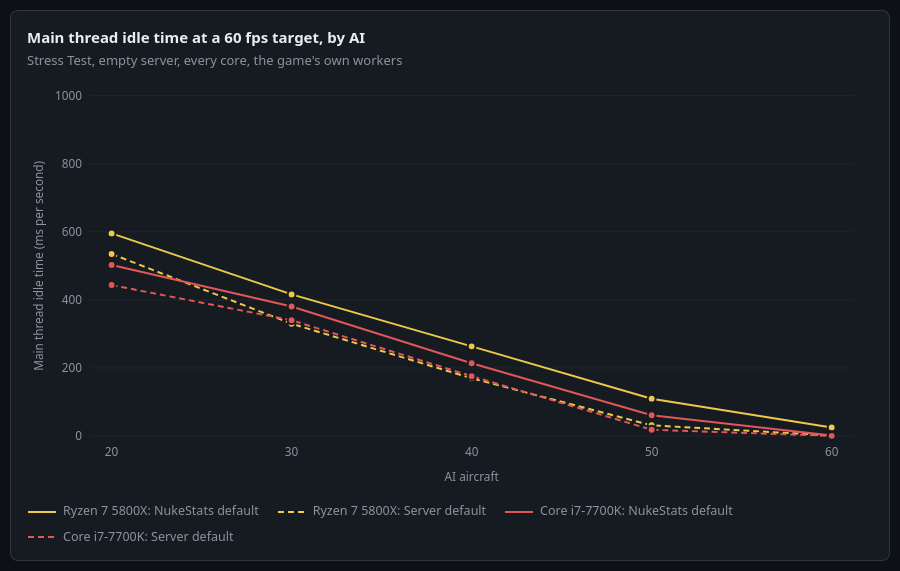
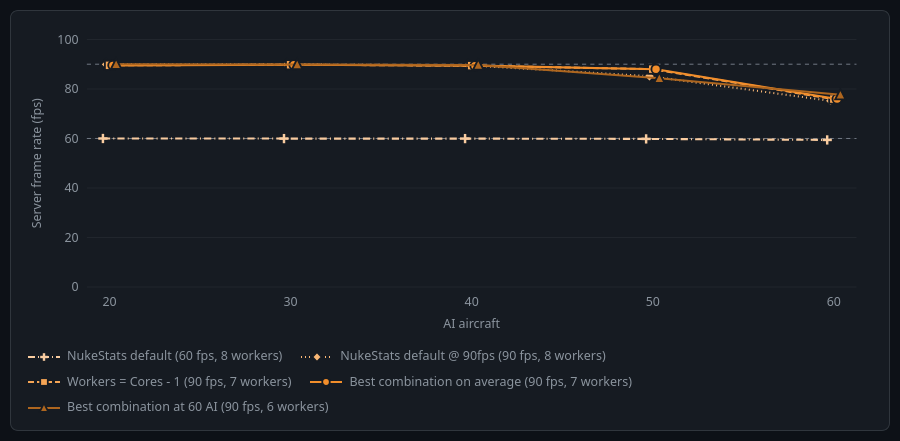
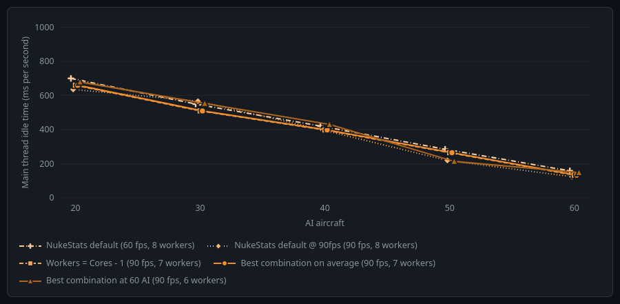
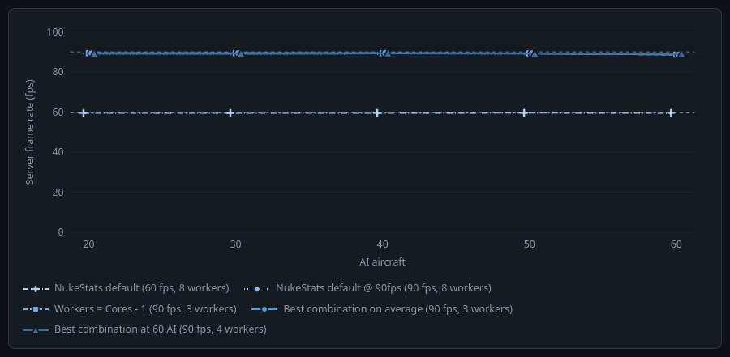
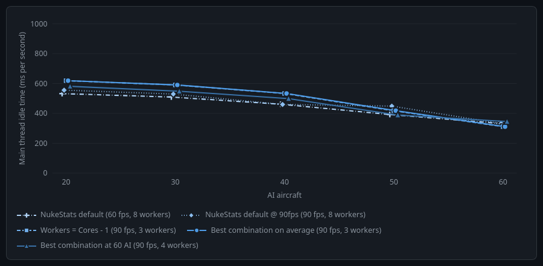
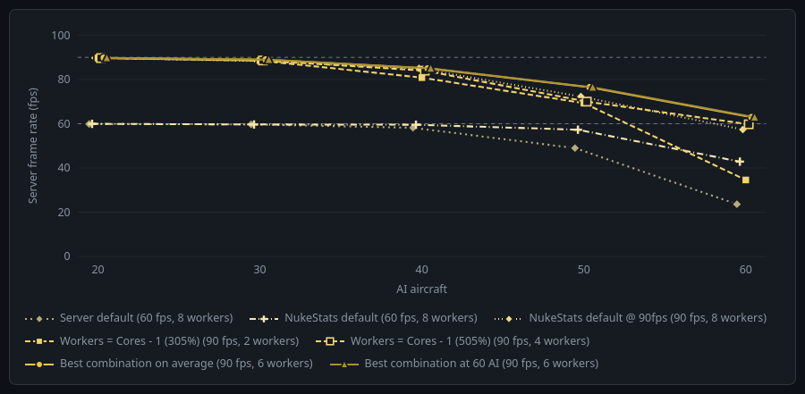
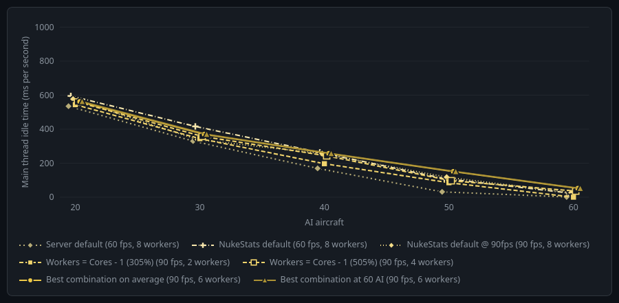
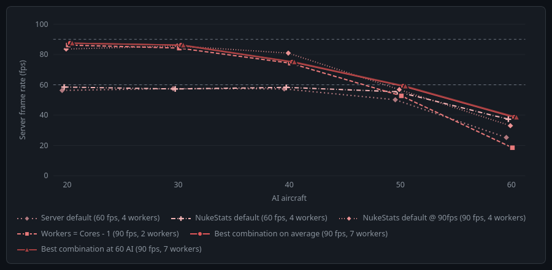
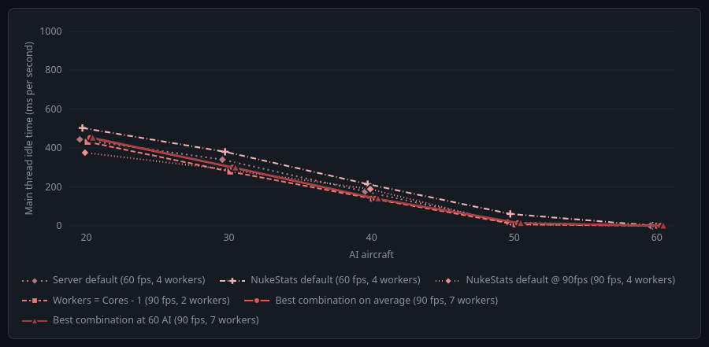

# Nuclear Option Server Tester

The Server Tester runs a private copy of the Nuclear Option dedicated server through a stress test and tells you which settings run it best on your machine. It works on Windows and Linux, and on a rented server the NukeStats plugin runs the same test itself.

**Download:** [the releases](https://github.com/Tomosnuclearbombos/nuclear-option-tester/releases)

During my attempts to optimise the server, I wanted to get more juice out of it whilst touching the engine as little as possible. No matter how light or heavy the server was running, nothing was able to hold 60 Hz, even at light settings. Speeding up or slowing down the engine was out of the question given the knock-on effects, so with some adjustments to how the server uses the CPU, and extensive testing, I created tests and tuning that get the server running much faster.

## Results

This is the Stress Test (aircraft only, guns only) on an empty server using every core, with each CPU at 60 AI aircraft. Main thread idle time is how many milliseconds of each second the server's main thread had nothing left to do, so more is better.

| CPU | Server default at 60 AI | NukeStats default at 60 AI | Best combination at 60 AI (90 fps) |
|---|---|---|---|
| Ryzen 7 5825U, 8 cores | not run | 59.4 fps, 158 ms idle | 77.6 fps, 148 ms idle (6 workers) |
| Core i7-12700H, 4 cores | not run | 59.6 fps, 333 ms idle | 88.9 fps, 345 ms idle (4 workers) |
| Ryzen 7 5800X, 305% and 505% limit | 23.6 fps, 2 ms idle | 42.9 fps, 25 ms idle | 62.9 fps, 52 ms idle (6 workers) |
| Core i7-7700K, 300% limit | 25.3 fps, 1 ms idle | 37.3 fps, 1 ms idle | 38.6 fps, 1 ms idle (7 workers) |

## How the optimisations help at 60 fps

The optimisations are NukeStats skipping work a server only does for a screen, given nobody watches the server and each player's game draws its own. It stops the pilot animation and the purely visual moving parts (ship wake foam, the rams on the missile trucks and the howitzer), skips wing vapour, propeller spin and smoke trails, and empties the particle effects. Flares, chaff, fires that do damage and missile parts are left alone.



Server default is the server as it comes. NukeStats default is the same with NukeStats on. The 5800X is the average of its two servers.

## Ryzen 7 5825U, 8 cores
**Server frame rate (fps) at each AI level**

| Setting | Target | Workers | 20 AI | 30 AI | 40 AI | 50 AI | 60 AI |
|---|---|---:|---:|---:|---:|---:|---:|
| NukeStats default | 60 fps | 8 | 60.0 | 60.0 | 60.0 | 59.8 | 59.4 |
| NukeStats default @ 90fps | 90 fps | 8 | 89.9 | 89.9 | 89.6 | 85.1 | 75.2 |
| Workers = Cores - 1 | 90 fps | 7 | 89.6 | 89.8 | 89.4 | 88.0 | 75.9 |
| Best combination on average | 90 fps | 7 | 89.6 | 89.8 | 89.4 | 88.0 | 75.9 |
| Best combination at 60 AI | 90 fps | 6 | 90.0 | 89.9 | 89.7 | 84.3 | 77.6 |



**Main thread idle time (ms per second) at each AI level**

| Setting | Target | Workers | 20 AI | 30 AI | 40 AI | 50 AI | 60 AI |
|---|---|---:|---:|---:|---:|---:|---:|
| NukeStats default | 60 fps | 8 | 700 | 550 | 421 | 285 | 158 |
| NukeStats default @ 90fps | 90 fps | 8 | 635 | 566 | 398 | 220 | 124 |
| Workers = Cores - 1 | 90 fps | 7 | 660 | 509 | 398 | 265 | 133 |
| Best combination on average | 90 fps | 7 | 660 | 509 | 398 | 265 | 133 |
| Best combination at 60 AI | 90 fps | 6 | 679 | 553 | 431 | 214 | 148 |




## Core i7-12700H, 4 cores
**Server frame rate (fps) at each AI level**

| Setting | Target | Workers | 20 AI | 30 AI | 40 AI | 50 AI | 60 AI |
|---|---|---:|---:|---:|---:|---:|---:|
| NukeStats default | 60 fps | 8 | 59.6 | 59.6 | 59.6 | 59.7 | 59.6 |
| NukeStats default @ 90fps | 90 fps | 8 | 89.1 | 89.0 | 89.2 | 89.1 | 88.9 |
| Workers = Cores - 1 | 90 fps | 3 | 89.3 | 89.4 | 89.4 | 89.3 | 88.7 |
| Best combination on average | 90 fps | 3 | 89.3 | 89.4 | 89.4 | 89.3 | 88.7 |
| Best combination at 60 AI | 90 fps | 4 | 89.2 | 89.1 | 89.3 | 89.2 | 88.9 |



**Main thread idle time (ms per second) at each AI level**

| Setting | Target | Workers | 20 AI | 30 AI | 40 AI | 50 AI | 60 AI |
|---|---|---:|---:|---:|---:|---:|---:|
| NukeStats default | 60 fps | 8 | 532 | 510 | 462 | 392 | 333 |
| NukeStats default @ 90fps | 90 fps | 8 | 556 | 529 | 460 | 449 | 332 |
| Workers = Cores - 1 | 90 fps | 3 | 619 | 591 | 533 | 418 | 311 |
| Best combination on average | 90 fps | 3 | 619 | 591 | 533 | 418 | 311 |
| Best combination at 60 AI | 90 fps | 4 | 581 | 548 | 499 | 389 | 345 |




## Ryzen 7 5800X, 305% and 505% limit
**Server frame rate (fps) at each AI level**

| Setting | Target | Workers | 20 AI | 30 AI | 40 AI | 50 AI | 60 AI |
|---|---|---:|---:|---:|---:|---:|---:|
| Server default | 60 fps | 8 | 59.9 | 59.7 | 58.2 | 49.0 | 23.6 |
| NukeStats default | 60 fps | 8 | 59.9 | 59.7 | 59.6 | 57.3 | 42.9 |
| NukeStats default @ 90fps | 90 fps | 8 | 89.8 | 88.3 | 85.0 | 72.3 | 57.4 |
| Workers = Cores - 1 (305%) | 90 fps | 2 | 89.7 | 88.5 | 80.8 | 69.3 | 34.6 |
| Workers = Cores - 1 (505%) | 90 fps | 4 | 89.7 | 88.6 | 84.0 | 70.0 | 59.7 |
| Best combination on average | 90 fps | 6 | 89.7 | 89.0 | 85.0 | 76.5 | 62.9 |
| Best combination at 60 AI | 90 fps | 6 | 89.7 | 89.0 | 85.0 | 76.5 | 62.9 |



**Main thread idle time (ms per second) at each AI level**

| Setting | Target | Workers | 20 AI | 30 AI | 40 AI | 50 AI | 60 AI |
|---|---|---:|---:|---:|---:|---:|---:|
| Server default | 60 fps | 8 | 535 | 330 | 170 | 32 | 2 |
| NukeStats default | 60 fps | 8 | 595 | 416 | 263 | 110 | 25 |
| NukeStats default @ 90fps | 90 fps | 8 | 577 | 339 | 256 | 118 | 27 |
| Workers = Cores - 1 (305%) | 90 fps | 2 | 544 | 344 | 197 | 85 | 1 |
| Workers = Cores - 1 (505%) | 90 fps | 4 | 560 | 358 | 243 | 97 | 36 |
| Best combination on average | 90 fps | 6 | 562 | 370 | 257 | 151 | 52 |
| Best combination at 60 AI | 90 fps | 6 | 562 | 370 | 257 | 151 | 52 |




## Core i7-7700K, 300% limit
**Server frame rate (fps) at each AI level**

| Setting | Target | Workers | 20 AI | 30 AI | 40 AI | 50 AI | 60 AI |
|---|---|---:|---:|---:|---:|---:|---:|
| Server default | 60 fps | 4 | 56.3 | 57.5 | 57.3 | 50.1 | 25.3 |
| NukeStats default | 60 fps | 4 | 58.5 | 57.2 | 58.3 | 55.4 | 37.3 |
| NukeStats default @ 90fps | 90 fps | 4 | 83.6 | 85.6 | 80.9 | 56.8 | 33.0 |
| Workers = Cores - 1 | 90 fps | 2 | 86.2 | 84.2 | 74.3 | 52.7 | 18.5 |
| Best combination on average | 90 fps | 7 | 87.4 | 86.1 | 75.0 | 59.1 | 38.6 |
| Best combination at 60 AI | 90 fps | 7 | 87.4 | 86.1 | 75.0 | 59.1 | 38.6 |



**Main thread idle time (ms per second) at each AI level**

| Setting | Target | Workers | 20 AI | 30 AI | 40 AI | 50 AI | 60 AI |
|---|---|---:|---:|---:|---:|---:|---:|
| Server default | 60 fps | 4 | 444 | 340 | 176 | 19 | 1 |
| NukeStats default | 60 fps | 4 | 503 | 381 | 214 | 61 | 1 |
| NukeStats default @ 90fps | 90 fps | 4 | 376 | 289 | 189 | 7 | 0 |
| Workers = Cores - 1 | 90 fps | 2 | 431 | 279 | 140 | 8 | 1 |
| Best combination on average | 90 fps | 7 | 452 | 299 | 140 | 15 | 1 |
| Best combination at 60 AI | 90 fps | 7 | 452 | 299 | 140 | 15 | 1 |




## Workers

A worker is a thread, not a core, and the game hands it the physics while the main thread runs everything else. The game picks its own count as half the threads it can see, never fewer than 2 and never more than 8, which is why it picked 8 on the 16 thread CPUs and 4 on the 8 thread 7700K. The 12700H got 8 given the game saw all 20 of the host's threads, although the server was only given 8 of them.

A rented server is not given cores either. Its limit (305% for example) is how much CPU time it can use across every thread on the host, and neither 5800X server used even 200% at 60 AI.

## How it was measured

Each setting ran for 30 seconds once it was set, at 20, 30, 40, 50 and 60 AI, with Workers = Cores - 1 measured again every few settings as the reference. Server default ran as its own test on the 5800X and the 7700K. The power profile was not the same on every machine, and both 5800X servers are on the same host.

## Send in your results

Run the same test on your server and send it in. Once I've checked it, it gets added to this page.

* **On your own PC**, run the Server Tester from a terminal in its folder (`ServerTester.exe` on Windows):

  ```
  ServerTester --cli --grid --grid-ai 20,30,40,50,60 --grid-targets 90 --grid-cores every --grid-workers 0,1,2,3,4,6 --ref-every 6 --grid-default
  ```

* **On a rented server**, the NukeStats plugin runs the same test itself. Put a file named `plugin_cmd_1.txt` in the server's game folder (the panel's file manager or SFTP) with this one line in it:

  ```
  selftest|start|Parts=grid;GridAi=20,30,40,50,60;GridTargets=90;GridCores=every;RefEvery=6;GridDefault=1;GridWorkers=0,1,2,3,4,6
  ```

  It starts once the server has been empty for two minutes, takes about 45 minutes, and leaves its results in `NukeStats-ServerTests` in the game folder.

Then open a new issue with the **Server benchmark** form and drag the test's `results.json` into it. It has no names or Steam IDs in it, just the machine and the measurements. If you rent, put the provider, the plan and its CPU limit in the form, given that is what people will want to compare.

## Notes

* The coding and design of the program was done using Claude but all functions and testing of the program were overseen by a human. Extensive data collection (not only the data sets seen here) was collected in refining the performance of multiple real servers using this program.
* The Server Tester, and the NukeStats plugin's own server test on a rented server, will identify the CPU your server is running on by default. This can be particularly helpful for those remotely hosting via a provider. In multiple cases, server CPUs (i.e. xgaming, legion hosting and others) didn't say or were misleading in what CPUs their servers used. Be wary as this will depend on the location and node you are placed on.
* A real in-game scenario where there is more than 60+ planes in the air will cause audio issues. 70+ AI planes causes errors. The server performance and the test running is not indicative that you can and should run a game with more than Nuclear Option's default player and AI limits. Most average gaming CPUs will tend to struggle in lobbies of more than 40+ planes or heavy missile scenarios. Keep this in mind if you're thinking of setting up a server with a large lobby.
* The NukeStats settings are only helpful under heavy load and on weaker CPUs. There is no need to use those settings unless your main thread idle time is quite low or near 0. In the first two examples, on our own hardware, the worker settings make little difference at these AI loads, but higher target frame settings and AI loads make that difference clearer.
* The stress tests are not perfect examples of real performance. AI is generally heavier on server performance than players (as players are only seen on the server as simple models which are less taxing). The more realistic benchmark test is likely far heavier than a real scenario you would find on a 16 player server. The settings and optimisations enabled by NukeStats are likely to have no noticeable performance gain in lighter settings.
* Testing with this much AI does not mean you can or should run missions with that much AI. This is purely a stress test of the server.
